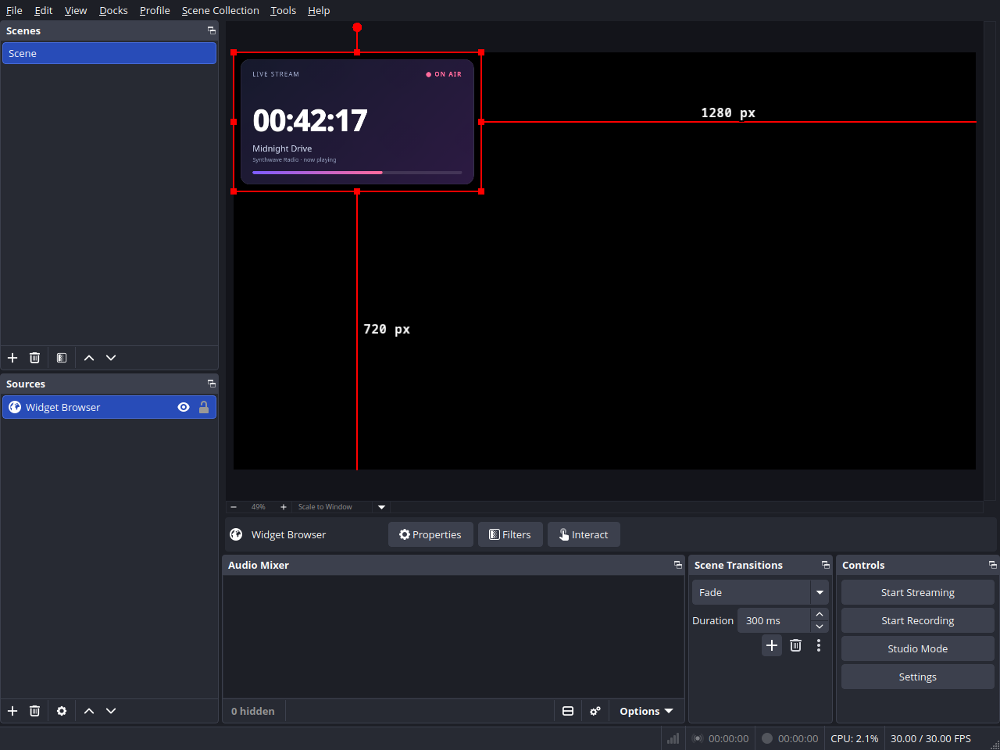
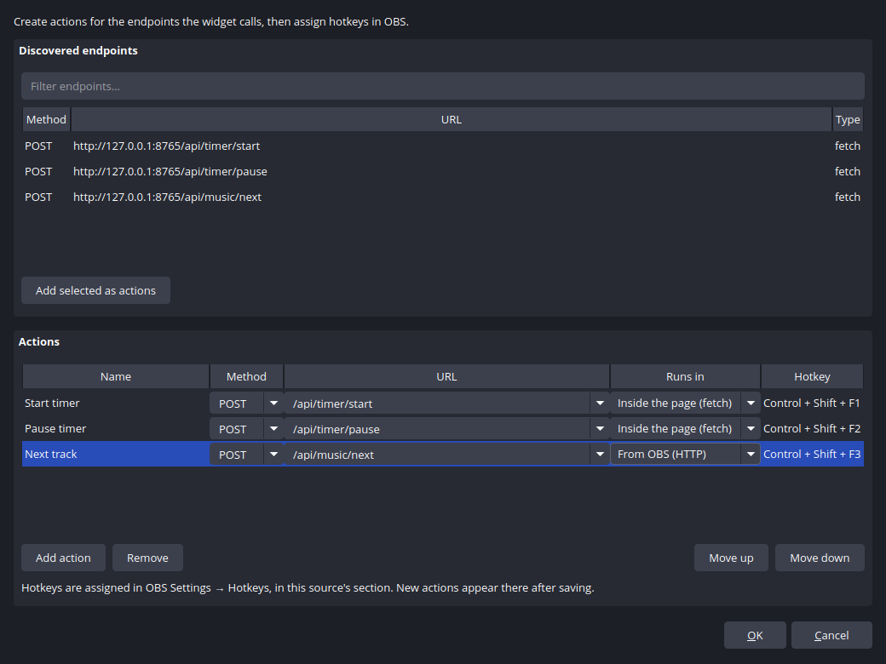

# obs-widget-browser

[](https://github.com/p7x-dev/obs-linux-browser-source/actions/workflows/build.yml)

A browser widget source for OBS Studio powered by **Qt WebEngine (Chromium 140)** — no CEF required.

It solves the problem of distributions where OBS ships without the built-in Browser Source (for example, Arch Linux builds `obs-studio` without obs-browser/CEF). It adds a **Widget Browser** source that displays any web page or widget by URL directly in a scene.

## Features

- New source type: *Widget Browser*
- Settings grouped into sections: URL, size and FPS (5–60), interaction, endpoints and actions; every option has a description
- **Interaction**: mouse and keyboard input from the OBS Interact window is forwarded to the page, and can be disabled
- **Endpoint discovery**: the plugin hooks `fetch`, `XMLHttpRequest`, `sendBeacon`, `EventSource` and `WebSocket` and lists every URL the widget requests
- **Actions and hotkeys**: any endpoint can be turned into an action with its own OBS hotkey
- Transparent background (StreamElements/Streamlabs and custom widgets work with the alpha channel)
- Off-screen rendering via `QQuickRenderControl` + `QWebEngineView`
- Works on X11 and Wayland
- Cross-platform: the same code builds on Linux / Windows / macOS (Qt WebEngine required)

## Screenshots





## Requirements

- OBS Studio (tested with 32.2.2)
- Qt 6.4+ with QtWebEngine, QtWebChannel and QtNetwork
- CMake 3.21+, a C++17 compiler

### Arch Linux

```sh
sudo pacman -S obs-studio qt6-webengine qt6-webchannel cmake ninja
```

## Build and install

```sh
cmake -B build -S . -G Ninja -DCMAKE_BUILD_TYPE=Release
cmake --build build
ctest --test-dir build          # unit tests (URL normalization)
./install-local.sh              # install into ~/.config/obs-studio/plugins
```

For a system-wide install:

```sh
cmake --install build --prefix /usr
```

### Arch Linux (AUR)

AUR packaging files are provided in [`aur/`](aur/); see
[`aur/README.md`](aur/README.md) for publishing and update instructions.
After the package is published, install it with:

```sh
yay -S obs-widget-browser
```

or manually:

```sh
git clone https://aur.archlinux.org/obs-widget-browser.git
cd obs-widget-browser
makepkg -si
```

Restart OBS Studio. The source will appear in the source list as **Widget Browser**.

## Releases

Tagged builds (`v*`) are built by CI and attached to GitHub Releases:

<https://github.com/p7x-dev/obs-linux-browser-source/releases>

The archive uses the OBS user-plugin layout:

```
obs-widget-browser/
  bin/64bit/obs-widget-browser.so
  data/locale/*.ini
```

Extract it into `~/.config/obs-studio/plugins/` and restart OBS. The CI build targets Arch Linux and links against the system Qt 6 and libobs.

## Interaction and actions

1. Add the source and enter the widget URL.
2. Use the widget normally: the plugin collects every endpoint it requests.
3. Open the source properties and click **Endpoints and actions…**.
4. In the editor window:
   - review or filter the discovered endpoints; select one or more and click
     **Add selected as actions** (or double-click an endpoint);
   - edit the action name, method, URL and execution target directly in the
     table;
   - use **Add action**, **Remove**, **Move up** and **Move down** to manage
     the list. The **Hotkey** column shows the combination currently assigned
     in OBS.
5. Save the dialog. Assign key combinations in **Settings → Hotkeys**, in this
   source's section.
6. For clicking and typing, open the source context menu → **Interact**. The
   **Allow mouse and keyboard input** checkbox in the source properties disables
   input forwarding if the widget should be display-only.

If the widget knows its endpoints in advance (for example, they are only called
from a button), it can declare them itself:

```js
window.__OBS_WIDGET_ENDPOINTS__ = [
  "/api/timer/start",
  { method: "POST", url: "/api/timer/reset" }
];
```

The same format is supported through `window.obsWidget.endpoints`.

## Windows / macOS

Qt WebEngine cannot be linked statically: the Qt libraries (including
`QtWebEngineProcess` and the Chromium resources) must be deployed next to
`obs-widget-browser.dll`/`.dylib`. The easiest way is to build with
[aqtinstall](https://aqtinstall.github.io/) and place Qt next to the plugin
(the standard approach for Qt-based OBS plugins).

## Known limitations

- **Linux: Chromium software compositing** (`--disable-gpu`) is enabled by
  default because the hardware path crashes the Mesa iris driver on some Intel
  iGPUs. Override it with `QTWEBENGINE_CHROMIUM_FLAGS="--use-gl=egl"` or similar
  (the variable value fully replaces the default).
- **Changing the URL recreates the renderer**, causing a short page reload
  (post-creation URL changes in off-screen Qt WebEngine are unreliable).
- Mouse and keyboard forwarding only works in the **Interact** window: clicks
  directly in the OBS preview are reserved for selecting and moving sources.
- Endpoint discovery sees requests from the page's main JavaScript context.
  Web Worker/Service Worker requests and WebSocket message contents are not
  captured — declare those endpoints via `window.__OBS_WIDGET_ENDPOINTS__`.
- Actions send requests with an empty body. If an endpoint requires a JSON body,
  use a `page` action with custom JavaScript on the page for now.
- H.264/AAC support in `<video>` depends on the distribution's QtWebEngine build
  (Arch includes H.264).
- OBS calls some source callbacks from non-main threads (obs-websocket); all Qt
  operations are marshalled to the main thread.

## Project layout

```
src/
  plugin.cpp            — module entry point, QtWebEngine initialization
  widget-source.cpp     — obs_source_info: settings, tick, texture rendering
  widget-renderer.cpp   — QQuickRenderControl + WebEngineView (frame capture,
                          input, WebChannel, action execution)
  url-utils.cpp         — URL normalization (pure logic)
  qml/WidgetView.qml    — the widget's QML scene
  qml/discovery.js      — injected JS: request interception and action runner
  qml/qwebchannel.js    — Qt WebChannel client library
tests/
  test_url_utils.cpp    — unit tests
data/locale/            — en-US, ru-RU
```

## License

GPL-2.0 (see LICENSE).
